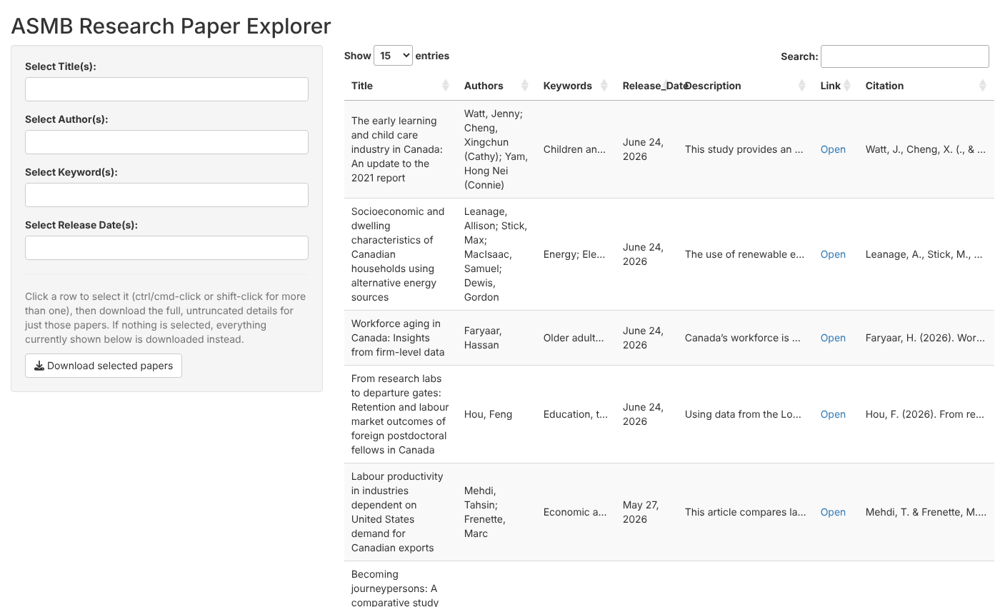

Statistics Canada's Analytical Studies and Modelling Branch (ASMB) is the agency's research arm. Since the mid-1990s it has released hundreds of studies on productivity, firm dynamics, immigration, education, health, housing and the environment, many of them built on linked microdata that few other researchers can use directly. For anyone working on the Canadian economy, it is one of the most useful bodies of applied research available, and all of it is free.

It is not always easy to search. Finding every paper by a particular author, or every study on a topic across 30 years and several publication series, usually means paging through catalogue listings one at a time. I built the [ASMB Research Paper Explorer](https://michaelwillox.github.io/ASMBResearchPaperExplorer/) to put the whole collection in one table.

{fig-alt="Screenshot of the ASMB Research Paper Explorer showing filter boxes for title, author, keyword and release date on the left and a table of papers with authors, keywords, release dates, descriptions, links and citations on the right."}

## What it does

The explorer covers 771 papers, from November 1994 to June 2026. Each one can be filtered by title, author, keyword and release date, and the filters narrow each other. For example, selecting an author limits the keyword list to topics that author has written on, and selecting a keyword then shows only the papers that match both. Papers with several authors or keywords appear once, but can be found under any of them.

The table shows a short description of each paper, a link to the release on the Statistics Canada website and a formatted citation. Rows can be selected and downloaded as a spreadsheet with the full, untruncated details. If nothing is selected, everything currently shown is downloaded.

## Who it is for

The most obvious use is a literature review. A graduate student starting a thesis on, say, business dynamics in Canada can see in a few seconds what ASMB has already published on the topic, who wrote it and when, and download a reading list with citations ready to paste. As well, it helps anyone planning new research to check whether a question has already been studied with Canadian data before starting on it. For people outside academia, including policy analysts and consultants, it is a quick way to find the authoritative Canadian evidence on a question and the researchers behind it.

## How it is built

The app is written in R with Shiny, the same tools many economists already use for analysis. It is compiled with Shinylive, which runs R inside the browser using WebAssembly, so there is no server behind it. It is hosted for free on GitHub Pages. That choice matters more than it might seem. A conventional Shiny app needs a server that has to be paid for and kept running; this one costs nothing and will keep working as long as GitHub Pages does. The first load takes a few seconds while R starts in the browser, and after that the filters respond immediately.

The data are a snapshot of the collection current to June 2026 and will be updated periodically. The code and data are on [GitHub](https://github.com/MichaelWillox/ASMBResearchPaperExplorer).

*The explorer is a personal project. It is not an official Statistics Canada product, and all papers link back to their official releases on the Statistics Canada website.*
