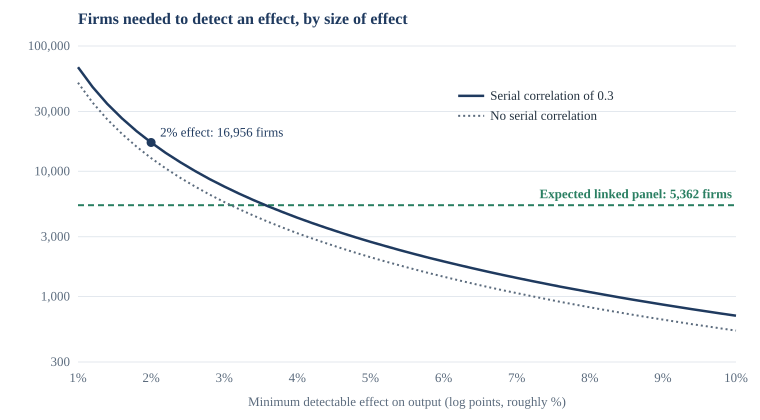

Many empirical studies are built by linking datasets. A survey is matched to administrative records, then to a second survey, then to the same files in later years, until there is a panel that follows each unit before and after some event. Each link loses observations. So does each extra year, as units drop out of the data. The point estimate of a treatment effect may be unchanged by all of this, but its standard error grows, and an effect that would be statistically significant in the full data can become impossible to distinguish from zero in the linked one.

The question that should come first is whether the panel that survives the linkage will be large enough to detect the effect the study is looking for. In practice it often comes last, after the data access request has been approved and the linkage is done. I built the [TWFE Panel Power and Data Linkage Feasibility Calculator](https://michaelwillox.github.io/twfe-power-calculator/) so that it can be answered in a few minutes at the start.

The calculator is written in terms of firms, but nothing in it is specific to business data. The same arithmetic applies to patients linked across hospital and pharmacy records, students linked from school files to tax records, workers linked across employer and household surveys, or facilities linked to emissions registries. It applies in any field where a treatment effect is estimated from a panel and linking datasets reduces the usable sample.

## Why I built it

The tool grew out of my working paper, *Clean Technology Investment and Firm Financial Performance: Evidence from Canadian Administrative Data*, part of my PhD thesis. That paper uses corporate tax records covering nearly all Canadian businesses to estimate how investing in clean energy and energy conservation equipment affects firms' revenue, employment and profitability. A natural next step would be to ask whether the same investments reduce energy use or emissions. That requires linking the tax records to facility-level energy and emissions data, which cover only a small fraction of firms. Once the linkage is done and firms are required to appear in every year, the group of investing firms becomes too small to estimate the effect with any precision. This is why the calculator's examples are framed around firms adopting a technology, with capital, labour and energy as baseline controls.

## What the calculator does

The calculator works out statistical power for a standard evaluation design. Firms are observed in a balanced panel over several years. Some of them adopt a technology or join a program in a common year, and they are compared with firms that never do. The effect is estimated with a two-way fixed effects (TWFE) regression, which controls for industry and year and for the inputs (capital, labour and energy) each firm used before treatment.

The user sets the minimum detectable effect, which is the smallest effect the study needs to be able to find, along with the share of firms that adopt, the variance of the outcome, how much of it is explained by industry and baseline inputs, the number of years before and after adoption, and the usual significance level and power. A second panel takes the starting number of firms, the linkage rate and the share of linked firms that stay in the panel for every year. The calculator then reports how many firms the study needs, how many it can expect to have, and the smallest effect the expected panel can reliably detect.

## An example

The default settings describe a fairly typical business case. An anchor survey has 15,000 firms. About 65% of them can be linked to the other files, and 55% of those remain in the data for all seven years. That leaves 5,362 firms, a net yield of 36%.

Suppose 10% of these firms adopt, there are three years of data before adoption and four after, and the goal is to detect a 2% effect on output with 80% power at the 5% level. The study needs 16,956 firms. The linked panel is short by 11,594, and the smallest effect it can reliably detect is about 3.6%.

That does not mean the study is not worth doing. The same panel is well powered for a 5% effect, which needs 2,734 firms, and a 10% effect needs only 703. However, a 1% effect would need 67,749 firms, more than four times the size of the original survey. Halving the effect to be detected roughly quadruples the sample required.

{fig-alt="Line chart on a log scale showing the number of firms needed falling from about 68,000 for a 1% effect to about 700 for a 10% effect, with a dashed line at 5,362 firms for the expected linked panel. The panel is large enough for effects of about 3.6% or more."}

The numbers in this example are illustrative. The calculator does not use any real or randomly simulated data. It computes all sample sizes and curves directly from closed-form analytical formulas, evaluated at the parameter values the user enters.

## Why serial correlation matters

Shocks to a firm's output tend to persist from one year to the next. When they do, an extra year of data on the same firm adds less information than an extra firm would. Bertrand, Duflo and Mullainathan (2004) showed how easily this is overlooked in difference-in-differences studies, and how much it overstates precision when it is.

The calculator models this with an AR(1) process and uses an exact closed-form variance rather than a rule of thumb. In the example above, a modest year-to-year correlation of 0.3 raises the required sample from 12,744 firms to 16,956, an increase of 33%. The effect is not monotonic. With only one year before and one year after adoption, higher correlation actually reduces the variance, because differencing removes the persistent part of the shock. With longer panels, moderate correlation increases the required sample substantially. The technical notes in the tool give the derivation.

## Where it fits

The calculator is a scoping tool. It is meant for the conversation that happens before a project starts: whether to request more years of data, whether a second survey is worth linking, or what size of effect a study can honestly promise to find. It is also useful for teaching, because the sliders show directly how each assumption moves the answer.

It is not a substitute for a project-specific simulation. Staggered adoption with effects that differ across firms (Callaway and Sant'Anna 2021; Sun and Abraham 2021), unbalanced panels, treatments that switch off, and clustering above the firm level are not modelled, and each of these generally requires a larger sample than the benchmark. The numbers it reports are best read as a lower bound. This matters for my own work, since the clean technology paper uses a staggered design.

The calculator runs entirely in the browser, and the code and documentation are on [GitHub](https://github.com/MichaelWillox/twfe-power-calculator). The chart in this post was produced from the calculator's default settings; the script to recreate it is [here](https://github.com/MichaelWillox/michaelwillox.github.io/tree/main/posts/twfe_power_calculator).

### References

Bertrand, M., Duflo, E., and Mullainathan, S. (2004). How Much Should We Trust Differences-in-Differences Estimates? *Quarterly Journal of Economics*, 119(1), 249–275.

Callaway, B., and Sant'Anna, P. H. C. (2021). Difference-in-Differences with Multiple Time Periods. *Journal of Econometrics*, 225(2), 200–230.

Schochet, P. Z. (2021). Statistical Power for Estimating Treatment Effects Using Difference-in-Differences and Comparative Interrupted Time Series Designs with Variation in Treatment Timing. *Journal of Educational and Behavioral Statistics*, 47(1), 71–103.

Sun, L., and Abraham, S. (2021). Estimating Dynamic Treatment Effects in Event Studies with Heterogeneous Treatment Effects. *Journal of Econometrics*, 225(2), 175–199.
